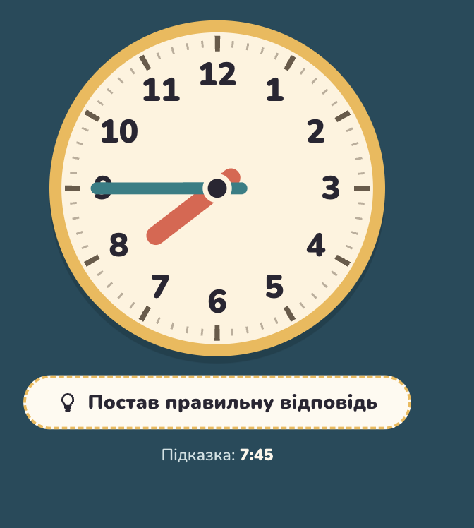
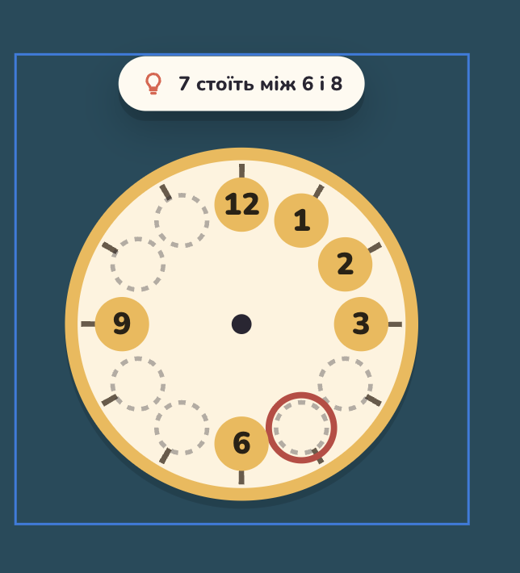

# 02 Play feel: request

The Player-tester's list as given on 2026-11-06 (session "teach time play-tweaks"), unedited apart from the ids. Ids (A1–A4) are used by the tickets; images are named after the ticket they belong to.

- **A1** Drag arrows. Here, circle to drag could be smaller, in the end, should be some small arrow which point to exacly place, where it would be put in. Maybe during dragging process or so. So user now exacally to which point it pointer.
- **A2** 30 min mode (00, 30) isn't needed
- **A3** Drag numbers. Make numbers circle with the same same. Also, sometimes when place is focused for number, I drop it but itsn't dropped. So When placement circle becomes focused or so, droppping should works always. If need, I can show in chrome devtools.
- **A4** Clock jumping when above or below appears text or button during test mode

Screenshots sent during the interview for A4 ("Clock jumps in next cases"):

