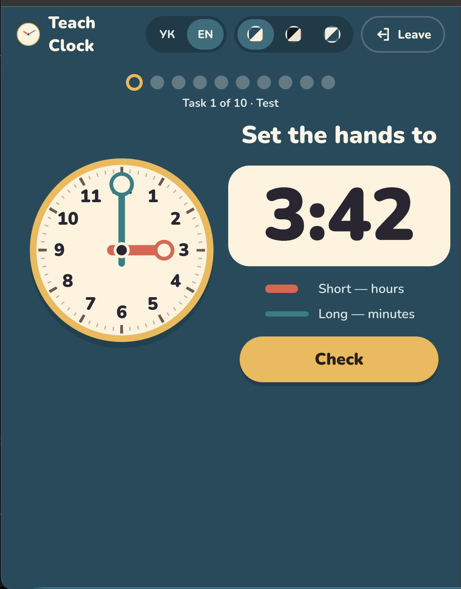
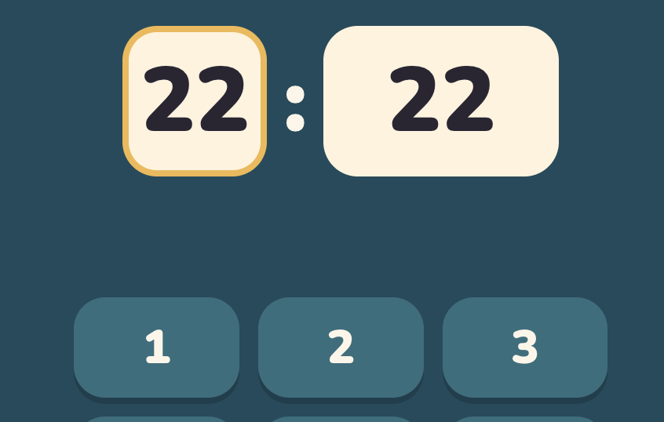
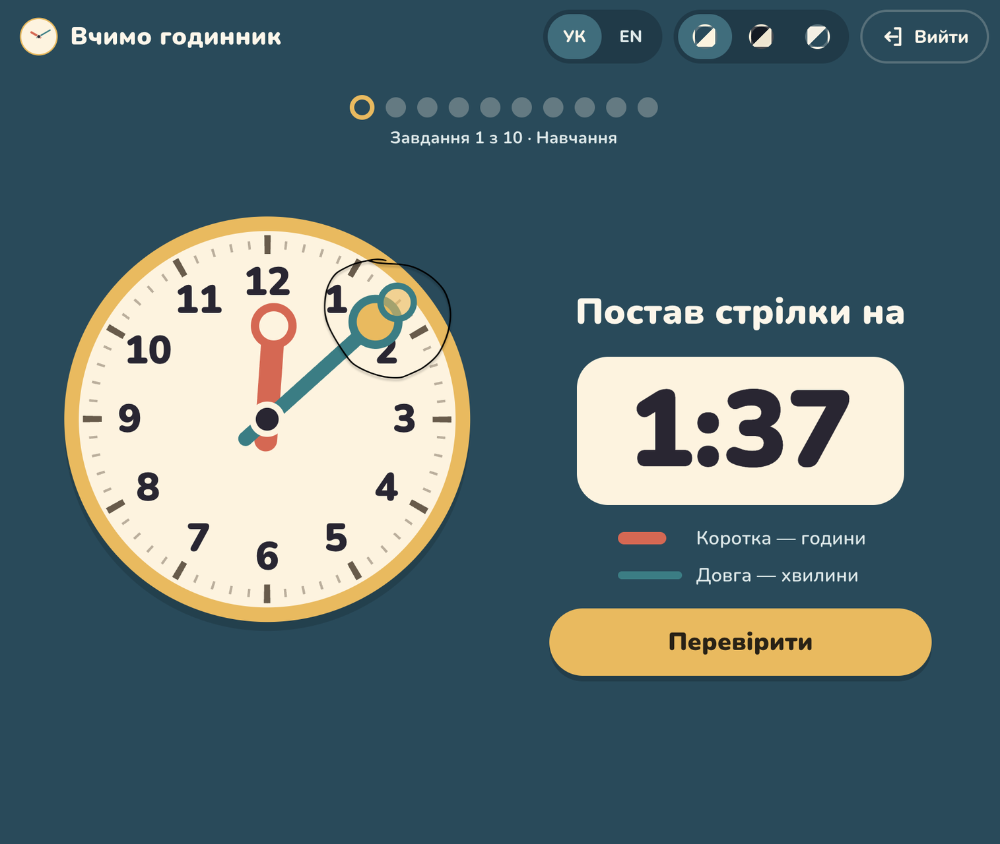
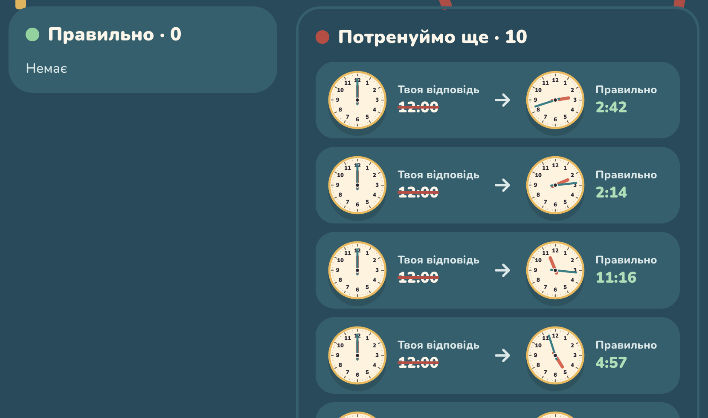

# 03 Readability: request

The Player-tester's list as given on 2026-11-09, unedited apart from the ids. Ids (A1–A7) are used by the tickets; images are named after the ticket they belong to.

- **A1** Drag Numbers should be the default Game.
- **A2** Teach / Test Mode choice: each should have its own icon next to the text.
- **A3** Drag Arrows (maybe other Games too): at about 768px wide and below, switch to the phone layout already. Today at 601px the clock is smaller than the other section, with too much free space below. 
- **A4** Set Time: under each input show a hint of which numbers are allowed. Less space between the inputs and the keypad. 
- **A5** Set Time: the hands point at a time; highlight the place they point to, like in Drag Arrows.
- **A6** Drag Arrows: make the highlighted target smaller so the circles don't overlap; maybe move the minute-hand grab circle a bit closer to the centre. 
- **A7** Summary: the clocks are too small; make them 2–3× bigger. Check other screens for the same issue. 
