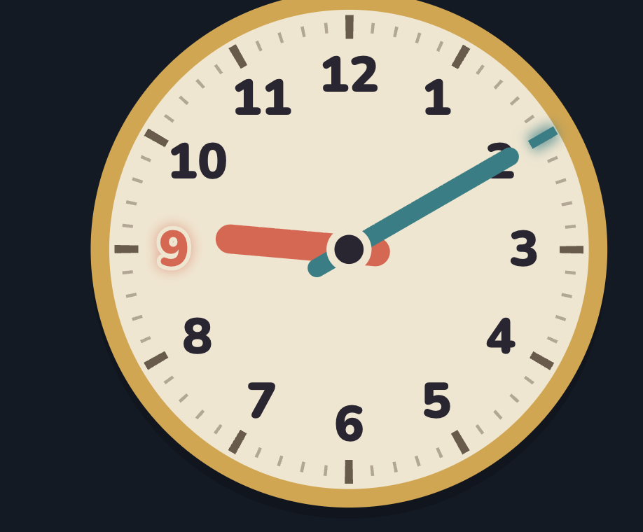

# 04 Clear hands: request

The Player-tester's notes as given on 2026-11-09 after 03-readability shipped, unedited apart from the ids. Ids (B1–B3) are used by the tickets; images are named after the ticket they belong to.

- **B1** "I see minute arrow is over numbers, its a bug" (Drag Arrows: the Minute Hand's grip covers the 3). 
- **B2** "here the same - minute. Also, in this mode minute arrow is over number - make arrow width smaller." (Set Time) 
- **B3** "don't highlight anything at all in test mode. the same for drag arrows"
