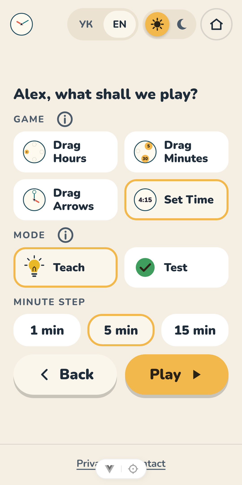
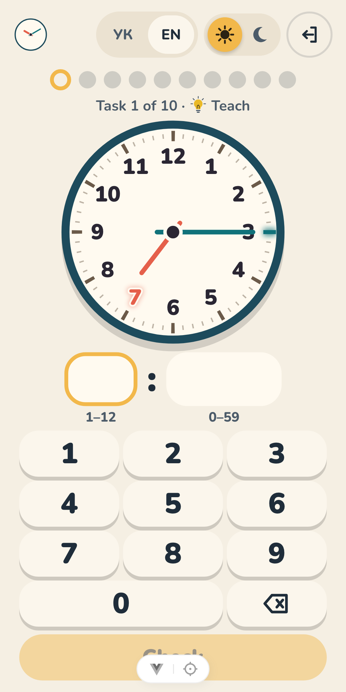
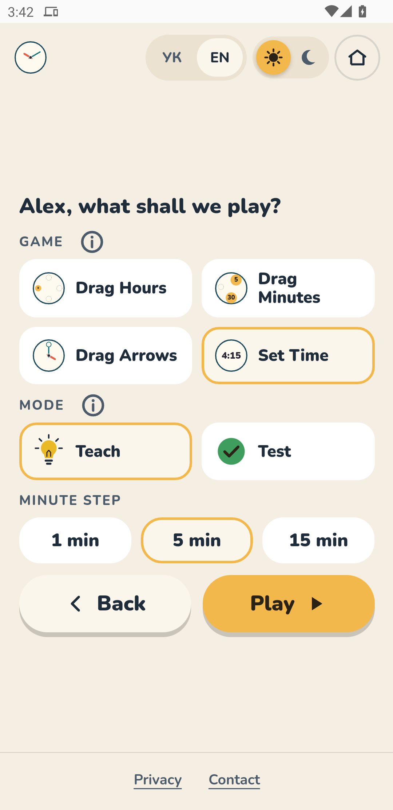
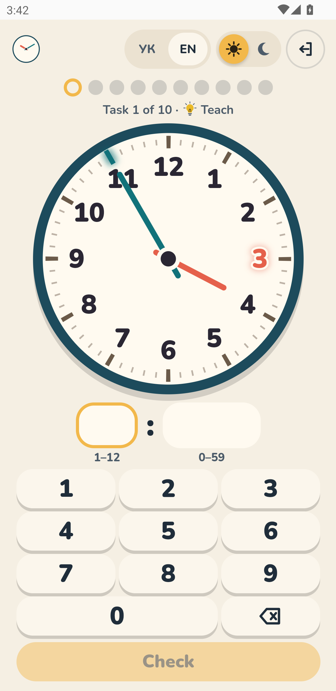

# 01 — The chosen cards and the clocks on an old system WebView

**Blocked by:** —
**Status:** done

## Cause

The S8's system WebView is older than Chrome 105. The app's JS runs there (taps work), but the CSS used features it lacks, and a browser drops a declaration it does not understand:

- **No border:** the chosen card's border came only from `.choice:has(.radio:checked)` (`ChoiceCard.vue`). `:has()` is Chrome 105.
- **No clock:** in the testers' build (before batch 19), the Set Time clock's width on a phone was `clamp(150px, 100svh - 500px, 100vw - 40px)`. `svh` is Chrome 108, so the declaration was dropped, the base `min(100%, 41cqi)` was dropped too (container units, Chrome 105), and the SVG had no width. Today's Drag Hours and Drag Minutes face had the same fault (`100svh` in `NumberBoard.vue`).
- **A trap found on the way:** a fallback declaration does not help when the newer value contains `var()`. The browser accepts such a value when it reads the CSS and checks it only when it is used, after it has already won the cascade; then the property is unset. Those need `@supports`.

Reproduced on Chromium 104 (`e2e/old-webview.spec.ts`, see `docs/android-checks.md`): the three chosen cards had a transparent border and the Drag Hours face was 0 px wide. `CSS.supports` there: `:has()`, `cqw`, `svh`, `dvh` all false; the same `clamp()` with `vh` true.

## Decisions

- The floor is Chrome 87 (`OLDEST_CHROME`, `src/config.ts`): flex `gap`, `min()`/`clamp()` and `inset` are native there, so only the newer features need fallbacks. `aspect-ratio` (Chrome 88) is left: every use but the desktop 4:3 stage is on an SVG whose `viewBox` keeps its shape.
- Fallbacks only, no "update your WebView" screen.
- The Round clock without container units: the screen's height less what the rest of the Round takes, measured once (Set Time 482 px, Drag Arrows 358 px; the same at 360 × 640, 360 × 720 and 412 × 839).
- A guard in Vitest over the source styles, not the built CSS: faster, and the build was checked to keep the fallbacks (Lightning CSS leaves the `vw`/`vh` line before its newer twin, and the `@supports` blocks).

## Checklist

- [x] `e2e/old-webview.spec.ts` (project `old-webview`, only with `OLD_CHROMIUM`): red on Chromium 104 before, green after; green on Playwright's Chromium.
- [x] `ChoiceCard.vue`: a `checked` class for the border; the keyboard focus ring on a sibling of the radio (`.radio:focus-visible ~ .ring`), same place and size as before.
- [x] `ClockFace.vue`: a `grabbing` class in place of `.draggable:has(.dragging)`.
- [x] `vw`/`vh` lines before every `cqi`/`svh`/`dvh` one; `@supports` where the value has `var()` (`NumberBoard.vue` face widths, `--safe-height` in `theme.css`) or where the clock fills a container (`RoundView.vue`, `WelcomeView.vue`).
- [x] `vite.config.ts`: `build.target` and `build.cssTarget` from `OLDEST_CHROME`.
- [x] `src/__tests__/cssFloor.spec.ts`: lists 26 problems on the stylesheets before the fix, none after.
- [x] `docs/android-checks.md` (Old system WebViews), `docs/tech-stack.md`.
- [x] Emulator: Android 12 (API 31) `google_apis` image, its stock WebView 91.0.4472.114 (older than Chrome 105, as the S8's), the debug APK, the tester's steps: Set Time, Teach and 5 min have the accent border, the Round's clock is 340 px wide.

  
  

- [ ] Ask the tester for the S8's WebView version (Settings → Apps → Android System WebView), to confirm it is 87 or newer.

## Message to the tester (draft)

> Thanks for the report and the screenshots! The missing border and the missing clock come from your phone's Android System WebView being older than the app expected. The next build works with it. Could you tell us its version? It is under Settings → Apps → (⋮ Show system apps) → Android System WebView, at the bottom of the page. Updating it from Google Play would also fix this for other apps.
