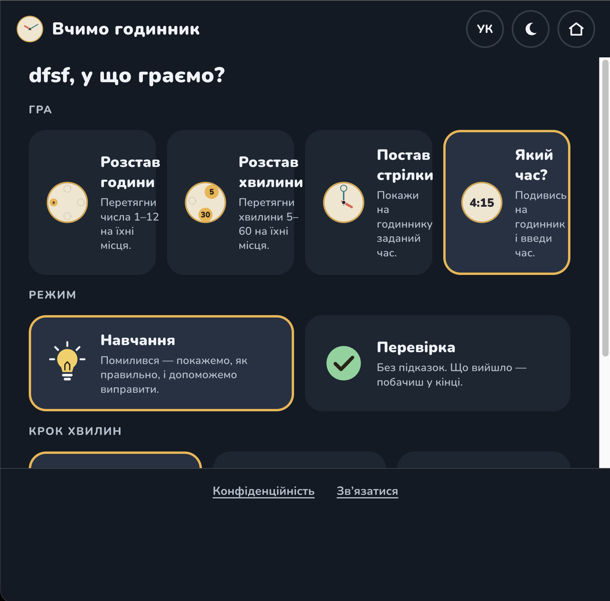
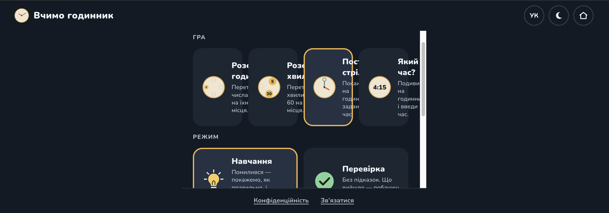
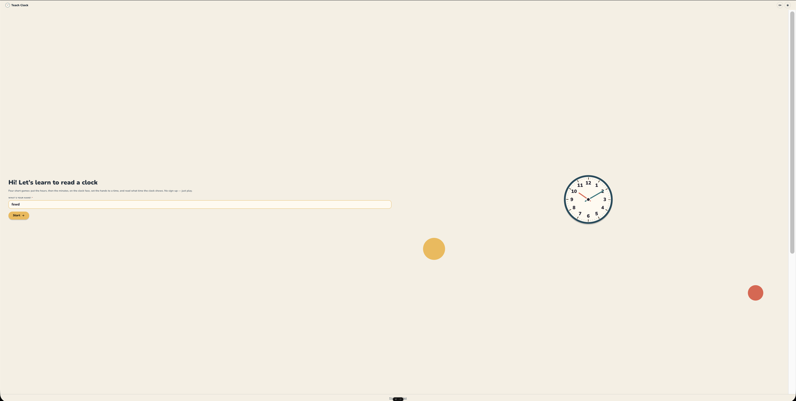

# 12: Desktop fills the window

**What to build:** Above 768 px the play area fills the window under the header instead of a 4:3 card capped at 1024 px. A screen's content stops at 1200 px, centred with free space left and right. The Footer sits at the bottom at its normal height, and a scrollbar, when one is needed, is at the window's right edge.

**Blocked by:** 01, 03

**Status:** done

- [x] The play area is the window's full width and height at 800 × 600, 1100 × 700, 1280 × 520, 1440 × 900 and 1920 × 1080
- [x] The content is at most 1200 px wide and centred, while `<main>` and its scrollbar stay at the window's full width
- [x] The header's brand and tools line up with the content column in a wide window
- [x] No empty band under the Footer, and the page itself never scrolls
- [x] Settings keeps Game titles whole: four cards in a row above 1100 px, two by two below
- [x] The page declares its theme's `color-scheme`, so scrollbars follow it
- [ ] A dark-theme scrollbar is seen in a real browser window
- [x] A Round's clock also fits the height, so Drag Hours and Drag Arrows fit 1280 × 520 without scrolling
- [x] The product brief describes the new layout
- [x] `e2e/phone-layout-768.spec.ts` checks that the stage fills the window
- [x] Welcome is viewed at 1920 × 1080 and 5152 × 2400
- [ ] The Summary is viewed at desktop widths
- [ ] The full browser suite is run on this layout

**Checked:** type-check, the CSS floor test, the 768 layout spec on the tablet project, and Settings and two Games' Rounds by screenshot.
