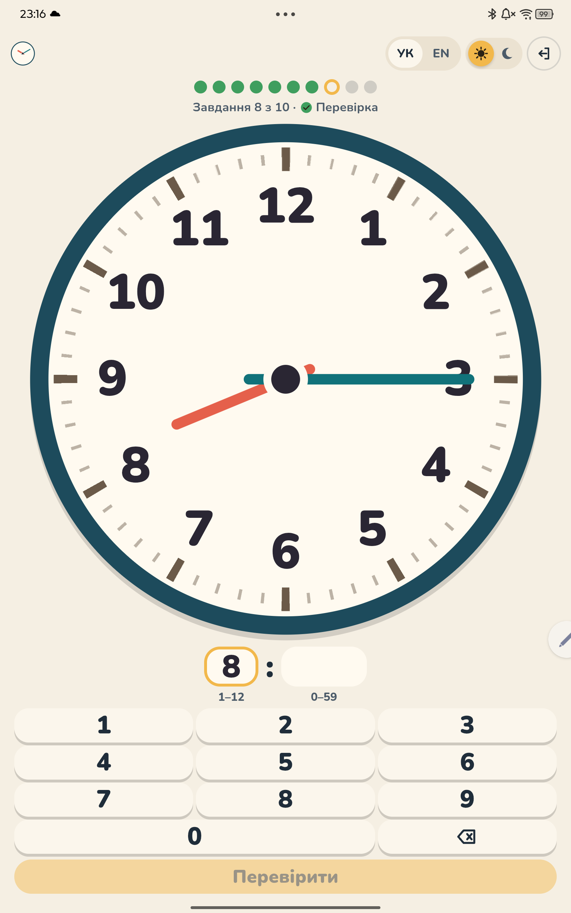

# Request

From GitHub issue #87, "UX enhancement", as given.

This is a UX enhancement, not a bug. Nothing is broken; the goal is to remove an unnecessary manual step. The time input has two fields: hours (1–12) and minutes (0–59). Users should not have to type leading zeros like "08" to move to the next field.

Currently, typing two digits in the hours field (for example "08", "01" or "12") automatically moves focus to the minutes field, and that works correctly. But typing a single digit from 2 to 9 (for example "8") keeps focus on the hours field, so the user has to switch to minutes manually, even though the value is already complete.

Expected behavior for hours: in a 1–12 format, a first digit from 2 to 9 cannot be followed by a second digit, because 20 and above is out of range. So after typing 2–9, the value is complete and focus should move to the minutes field immediately. After typing 1, the field should wait for a second digit, because 10, 11 and 12 are possible. After typing 0, the field should also wait, because 01–09 are valid.

Apply the same logic to minutes (0–59): a first digit from 6 to 9 is complete on its own (for example "7" means 07), so the input should be treated as finished. A first digit from 0 to 5 should wait for a second digit.

Keep the existing two-digit behavior unchanged. Typing "08" or "12" must still work exactly as it does now. Acceptance check: typing "8" moves focus to minutes; typing "1" stays in hours, and then typing "1" again gives 11 and moves to minutes; typing "0" and then "8" gives 08 and moves to minutes.

