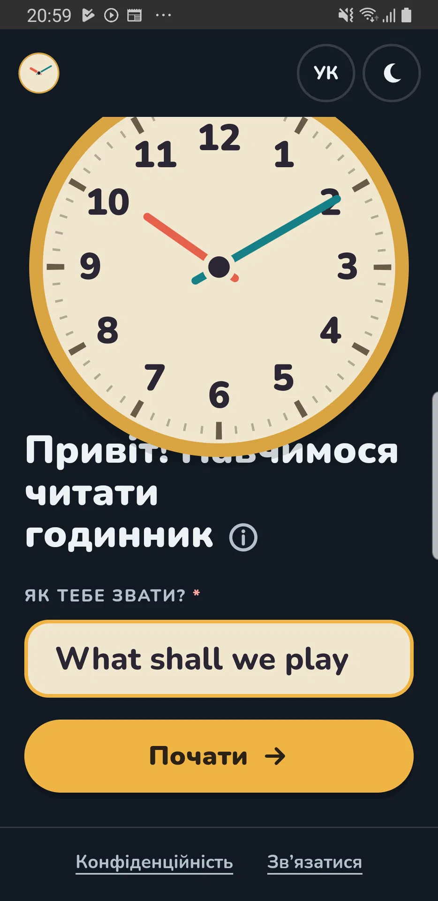

# Request

A report from the author, as given.

## Samsung S8, Android 9: Welcome

> [screenshot] in Samsung S8 - android 9 please check

## Cause and fix

On a phone, Welcome's clock box takes only the height left after the heading, name field and Start. The clock fit that box only through container units (`min(100cqw, 100cqh)`), which the S8's system WebView (older than Chrome 105) lacks. There the clock kept the column's full width in a shorter box and spilled out of it, centred: under the header and over the heading. Without container units the clock is now laid over the whole box, and its viewBox fits the face to the box's smaller side (`src/views/WelcomeView.vue`). `e2e/old-webview.spec.ts` checks on Chromium 104 that the clock sits below the header and above the heading.

The name in the field ("What shall we play") was typed text, not a bug.
