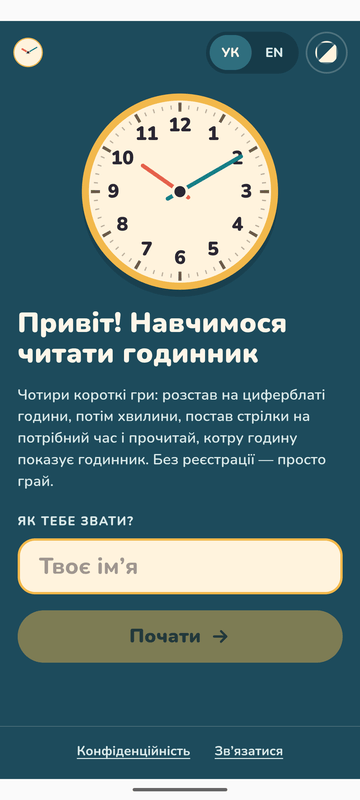
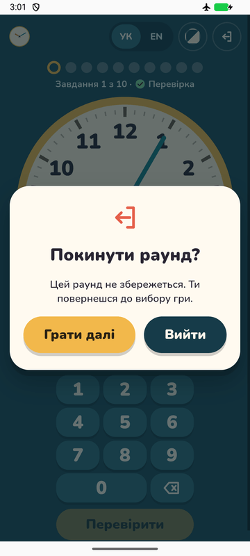
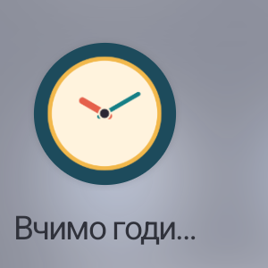
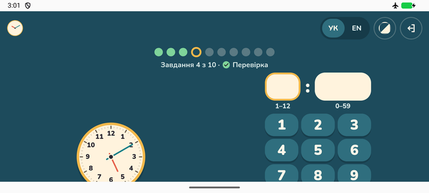

# Android checks

The checks that show the Android App is fit for Google Play review (batch 08, ticket 10). Run them again before each release that changes `android/`, Capacitor or a plugin.

## Permission check (automatic)

`npm run check:android` reads the manifest Gradle merges from the app and every library, lists the permissions it requests, and fails if one is not allowed in an app for children (Families policy):

- any `android.permission.ACCESS_*LOCATION`
- `com.google.android.gms.permission.AD_ID`

It needs a Gradle build first, so in CI it runs **after** `./gradlew bundleRelease`:

```sh
npm run build:android
(cd android && ./gradlew bundleRelease)
npm run check:android
```

By default it reads `android/app/build/intermediates/merged_manifest/release/processReleaseMainManifest/AndroidManifest.xml`, or the debug one if only a debug build exists. Pass a path to check another manifest: `npm run check:android -- path/to/AndroidManifest.xml`. Exit codes: 0 ok, 1 a banned permission, 2 no merged manifest (build first).

Result on 2026-11-13 (Capacitor 8.6.2, `@capacitor/app` 8.1.2): only `android.permission.INTERNET` and `app.teachclockforkids.DYNAMIC_RECEIVER_NOT_EXPORTED_PERMISSION` (from androidx core). Passes.

## Device checks (by hand)

Done on 2026-11-13 on the emulator (AVD `Medium_Phone_API_36.1`, Android 16 / API 36, 1080×2400), with the debug build of the same web assets (`./gradlew assembleDebug`). The steps were driven with Playwright's `_android` WebView driver plus `adb`, as a person would tap them.

- [x] **Fresh install, airplane mode, first launch.** Uninstalled, turned airplane mode on (`adb shell cmd connectivity airplane-mode enable`, no active network), installed, opened. Welcome came up with the font and art; nothing needed the internet.
- [x] **A full Round in each Game, offline, on that first run:** Set Time (Test, Level 5), Drag Arrows (Test, Level 15), Drag Hours (Teach, with a wrong drop), Drag Minutes (Test). Each reached its Summary.
- [x] **Back button, as ticket 09 says:**
  - Settings → Welcome.
  - In a Round, back opens the leave dialog; back again closes it (Keep playing) and the Round goes on at the same Task. Back never leaves a Round.
  - Teach wrong-answer popup: back closes the popup first; the Round stays.
  - Summary → Welcome (after every Game).
  - Welcome → leaves the app (the launcher is on top).
- [x] **Rotate:** in a Set Time Round, turned to landscape and back. Same Task, same clock, no reload, no white screen. Landscape on a phone scrolls (the pad is below the fold), which is fine.
- [x] **Background and resume:** Home in the middle of a Round, then opened the app again. Same Task.
- [x] **No Support Button** on Welcome or Settings (the Android build never renders it).
- [x] **Footer links leave the app:** Privacy opens Chrome (the public Privacy Page URL); Contact opens the mail app (Gmail). The app stays on its own page underneath.
- [x] **Launcher icon:** the teal circle with the clock, label "Вчимо годи…" (Pixel launcher, circle mask).
- [x] **Android 12+ splash:** teal background with the clock in the middle, then Welcome.

| Splash | Welcome, offline | Back in a Round | Launcher icon |
| --- | --- | --- | --- |
|  |  |  |  |



## What the emulator does not prove

- **OEM icon masks and launchers.** Only the Pixel launcher's circle was seen. Samsung (squircle), Xiaomi and others may crop the adaptive icon differently; check on a real phone or in Play Console's preview.
- **Themed icons (Android 13+).** The adaptive icon has no `monochrome` layer, so with themed icons on, the launcher shows the normal coloured icon.
- **The signed release build.** The checks used the debug APK (same web assets, same manifest permissions). The `.aab` from CI is only tested when Google Play's pre-launch report runs it, or on an internal-testing install.
- **Older Android versions.** Only API 36 was run. On Android 7–11 (minSdk 24) the splash is the old full-screen `splash.png`, and an old system WebView may behave differently.
- **Real touch and speed.** Drags were sent as synthetic mouse events through the WebView; a child's finger on a slow phone was not tried.
- **Gesture back vs. 3-button back.** Back was sent as `KEYCODE_BACK`; the system back gesture and predictive back animation were not tried.
