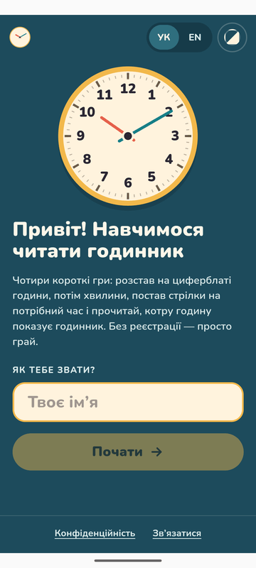
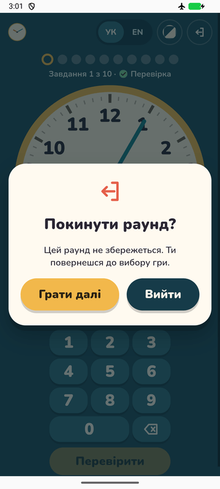
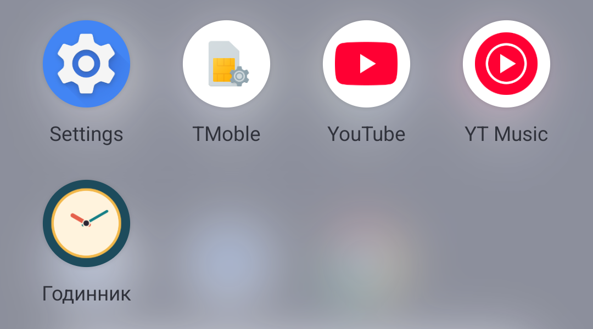
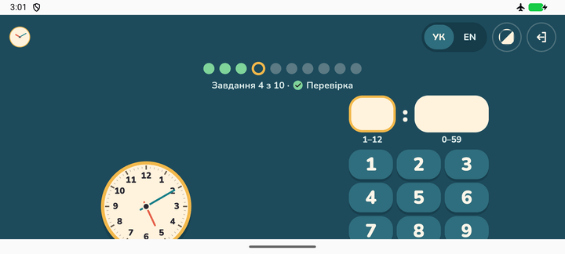

# Android checks

The checks that show the Android App is fit for Google Play review (batch 08, ticket 08). Run them again before each release that changes `android/`, Capacitor or a plugin.

## Permission check (automatic)

`npm run android:check` reads the manifest Gradle merges from the app and every library, lists the permissions it requests, and fails if one is not allowed in an app for children (Families policy):

- any `android.permission.ACCESS_*LOCATION`
- `com.google.android.gms.permission.AD_ID`

It needs a Gradle build first, so in CI it runs **after** `./gradlew bundleRelease`:

```sh
npm run android:sync
(cd android && ./gradlew bundleRelease)
npm run android:check
```

By default it reads `android/app/build/intermediates/merged_manifest/release/processReleaseMainManifest/AndroidManifest.xml`, or the debug one if only a debug build exists. Pass a path to check another manifest: `npm run android:check -- path/to/AndroidManifest.xml`. Exit codes: 0 ok, 1 a banned permission, 2 no merged manifest (build first).

Result on 2026-11-13 (Capacitor 8.6.2, `@capacitor/app` 8.1.2): only `android.permission.INTERNET` and `app.teachclockforkids.DYNAMIC_RECEIVER_NOT_EXPORTED_PERMISSION` (from androidx core). Passes.

## Device checks (by hand)

Done on 2026-11-13 on the emulator (AVD `Medium_Phone_API_36.1`, Android 16 / API 36, 1080×2400), with the debug build of the same web assets (`./gradlew assembleDebug`). The steps were driven with Playwright's `_android` WebView driver plus `adb`, as a person would tap them.

- [x] **Fresh install, airplane mode, first launch.** Uninstalled, turned airplane mode on (`adb shell cmd connectivity airplane-mode enable`, no active network), installed, opened. Welcome came up with the font and art; nothing needed the internet.
- [x] **A full Round in each Game, offline, on that first run:** Set Time (Test, Level 5), Drag Arrows (Test, Level 15), Drag Hours (Teach, with a wrong drop), Drag Minutes (Test). Each reached its Summary.
- [x] **Back button, as ticket 07 says:**
  - Settings → Welcome.
  - In a Round, back opens the leave dialog; back again closes it (Keep playing) and the Round goes on at the same Task. Back never leaves a Round.
  - Teach wrong-answer popup: back closes the popup first; the Round stays.
  - Summary → Welcome (after every Game).
  - Welcome → leaves the app (the launcher is on top).
- [x] **Rotate:** in a Set Time Round, turned to landscape and back. Same Task, same clock, no reload, no white screen. Landscape on a phone scrolls (the pad is below the fold), which is fine.
- [x] **Background and resume:** Home in the middle of a Round, then opened the app again. Same Task.
- [x] **Footer links:** Privacy opens the Privacy Page inside the app, and the back button returns to the screen that opened it (batch 09). Contact opens the mail app (Gmail). The app stays on its own page underneath.
- [x] **Launcher icon:** the clock on a dark circle (the dark theme's background) (Pixel launcher, circle mask).
- [ ] **Name follows the phone's language (batch 13, ADR 0005):** with English first in Settings → System → Languages, the name under the icon and in recent apps reads "Teach Clock"; move Ukrainian above English and both read "Вчимо годинник". The name is the full Game Name in both; a cut-off on a one-line launcher is accepted. The interface language inside the app is a separate check.
- [ ] **Interface language follows the phone (batch 13):** on a fresh install, English first opens Welcome in English and Ukrainian first in Ukrainian; after a tap on УК/EN the app keeps that choice on the next launch, while the name under the icon stays the phone's.
- [ ] **Keyboard on Welcome (batch 19):** a tap on the name field opens the keyboard; the screen pans up (`adjustPan`), the clock keeps its size and the field stays in view while typing.
- [ ] **Play's update screen (batch 20):** needs a build installed from Play (closed testing), not the debug APK or the emulator, and a newer build uploaded after it. Open the app on Welcome: Play's "Update available" screen comes up in the phone's language; Update downloads it and restarts the app into the new version. ✕ closes it and the app goes on; it does not come back until the app is started again. Start a Round, send the app to the background and back: nothing opens in the Round. Play can take a few hours to see a new build, so check the day after an upload.
- [x] **System bars (batch 21):** on an emulator with a camera cutout (Pixel 8 or "Display cutout: Punch hole" in Developer options), in 3-button and in gesture navigation, light and dark theme: the clock, УК/EN, the sun/moon and Home sit below the status bar and clear of the cutout and every one of them taps; Privacy and Contact sit above the navigation bar; the header's colour runs under the status bar; the bar icons are dark on light, light on dark, and switch with the sun/moon. Turn the phone sideways on Welcome and Settings: nothing under the cutout or the navigation bar. A popup (ⓘ on Welcome) stays between the bars.
- [x] **Android 12+ splash:** dark background (the dark theme's) with the clock in the middle, then Welcome.

| Splash                                                    | Welcome, offline                                                                     | Back in a Round                                                                       | Launcher icon                                                           |
| --------------------------------------------------------- | ------------------------------------------------------------------------------------ | ------------------------------------------------------------------------------------- | ----------------------------------------------------------------------- |
|  |  |  |  |



## Old system WebViews (batch 22)

The Android App draws with the phone's system WebView, which a never-updated phone keeps at the version it shipped with. A Samsung S8 in closed testing showed no border on the chosen Settings cards and no clock in a Set Time Round: its WebView was older than Chrome 105, and those rules used `:has()` and container units (Chrome 105) and `svh` (Chrome 108). The JS ran, so taps still worked.

- **The floor is Chrome 87** (`OLDEST_CHROME` in `src/config.ts`). Vite builds the JS and CSS for it (`build.target`, `build.cssTarget`).
- **`src/__tests__/cssFloor.spec.ts`** (in `npx vitest run`) fails on `:has()`, container units (`cqi`, `cqw`…) or `svh`/`dvh`/`lvh` without a fallback. A fallback is either `@supports` around the rule, or, for a value without `var()`, a declaration of the same property just before that an old WebView understands (`vw`, `vh`). A value with `var()`, or a custom property, cannot fall back that way: the browser checks it only when it is used, after it has already won, so it needs `@supports`.
- **`e2e/old-webview.spec.ts`** runs the reported steps on an old Chromium: the chosen cards have the accent border, and the Welcome clock, the Set Time clock and the Drag Hours face show. It only runs when `OLD_CHROMIUM` names a Chromium binary:

  ```sh
  # Chromium 104 (the last without :has() and container units), arm64 Mac
  npx @puppeteer/browsers install chromium@1012729 --platform mac_arm --path /tmp/old-chromium
  OLD_CHROMIUM=/tmp/old-chromium/chromium/mac_arm-1012729/chrome-mac/Chromium.app/Contents/MacOS/Chromium \
    npx playwright test --project old-webview
  ```

  Playwright's locators call `Element.checkVisibility()` (Chrome 105), so the spec drives the page with plain DOM calls. Snapshots older than Chrome 88 exist only for Intel Macs (Rosetta).

- **On a device:** the Android 12 (API 31) `google_apis` emulator image, without Play, has WebView 91 (`adb shell dumpsys webviewupdate`). Done on 2026-11-19 with the debug APK: the chosen cards have their border and the Set Time clock shows (`.scratch/22-old-webview/issues/01-old-webview.md`).

## What the emulator does not prove

- **OEM icon masks and launchers.** Only the Pixel launcher's circle was seen. Samsung (squircle), Xiaomi and others may crop the adaptive icon differently; check on a real phone or in Play Console's preview.
- **Themed icons (Android 13+).** The adaptive icon has no `monochrome` layer, so with themed icons on, the launcher shows the normal coloured icon.
- **The signed release build.** The checks used the debug APK (same web assets, same manifest permissions). The `.aab` from CI is only tested when Google Play's pre-launch report runs it, or on an internal-testing install.
- **Older Android versions.** Only API 36 was run for these checks. On Android 7–11 (minSdk 24) the splash is the old full-screen `splash.png`. Old system WebViews are covered in [Old system WebViews](#old-system-webviews-batch-22).
- **Real touch and speed.** Drags were sent as synthetic mouse events through the WebView; a child's finger on a slow phone was not tried.
- **Gesture back vs. 3-button back.** Back was sent as `KEYCODE_BACK`; the system back gesture and predictive back animation were not tried.
